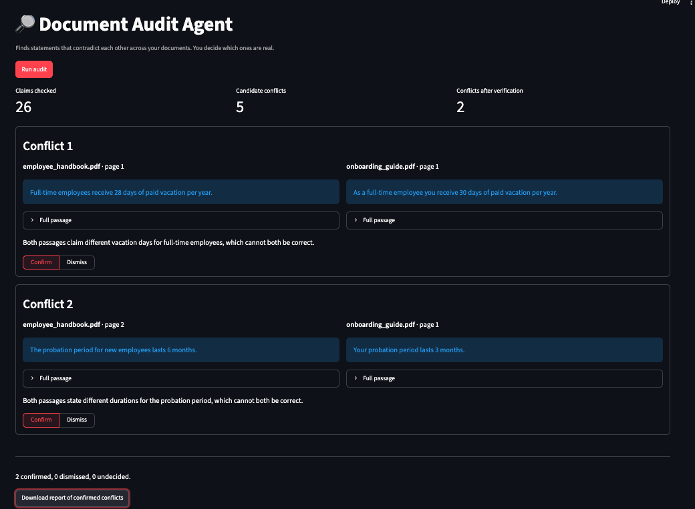

# Document Audit Agent

An agent that finds statements that contradict each other across a set of PDF documents, for example a handbook that grants 28 vacation days while the onboarding guide promises 30. It reports each conflict with both passages quoted and cited, and a person confirms or dismisses each one.

Built with Python, LangGraph, LangChain, Chroma and Streamlit.



*A run on two of the test documents (`employee_handbook.pdf` and `onboarding_guide.pdf`) with `groq:openai/gpt-oss-20b`. The agent extracted 26 claims, the judge flagged 5 candidate conflicts, and verification kept 2: both contradictions planted between these two documents.*

## How it works

```
extract ──(one branch per claim)──> investigate ──> collect
                                                       │
        report <── verify <──(one branch per candidate)┘

investigate:   search ──> judge ──(judge asks for a different search)──> search
                            └────(done)──> end
```

1. **Extract.** The LLM reads every indexed passage and lists its checkable claims (numbers, deadlines, limits, responsibilities).
2. **Investigate.** For each claim, the agent searches the *other* documents in the Chroma index and the LLM judges every passage found: conflict, agree or unrelated. If nothing on the claim's topic was found, the LLM can propose a reworded query and the agent searches once more. Claims are investigated in parallel.
3. **Verify.** A second, sceptical LLM pass re-reads both full passages for every candidate conflict and must quote the conflicting text from each. Code then checks that both quotes really appear in the passages; if not, the candidate is rejected. This removes false alarms such as a general rule versus its stated exception.
4. **Report.** The same conflict found from both sides (A vs B and B vs A) is merged into one.
5. **Human review.** In the UI you confirm or dismiss each conflict and download a report of the confirmed ones.

Every LLM step returns structured output (Pydantic models), so the graph branches on fields rather than parsing free text.

## Setup

Requires Python 3.10+ and an API key from an LLM provider (Groq, Anthropic, Google or OpenAI).

### 1. Install

**With pip**

```bash
python -m venv .venv
source .venv/bin/activate          # Windows: .venv\Scripts\activate
pip install -r requirements.txt
```

**With [uv](https://docs.astral.sh/uv/)**

```bash
uv venv
uv pip install -r requirements.txt
```

### 2. Create a `.env` file

The app will not run without this file. Copy the template and fill in your own key and model:

```bash
cp .env.example .env
```

Then open `.env` and set one provider's API key and the matching `CHAT_MODEL`, for example:

```
GROQ_API_KEY=your-key-here
CHAT_MODEL=groq:openai/gpt-oss-20b
```

`CHAT_MODEL` is written as `provider:model`, and the key's name depends on the provider:

| Provider | Key name | Example `CHAT_MODEL` |
| --- | --- | --- |
| Groq | `GROQ_API_KEY` | `groq:openai/gpt-oss-20b` |
| Anthropic | `ANTHROPIC_API_KEY` | `anthropic:claude-sonnet-5-5` |
| Google | `GOOGLE_API_KEY` | `google_genai:gemini-2.5-flash` |
| OpenAI | `OPENAI_API_KEY` | `openai:gpt-4o-mini` |

Never commit `.env`: it contains your secret key. It is listed in `.gitignore`.

### 3. Run

```bash
streamlit run app.py               # with uv: uv run streamlit run app.py
```

The first start downloads the embedding model (about 90 MB), which runs locally. Upload at least two PDFs, index them, and click **Run audit**.

To try it immediately, upload the six test documents from `evaluation/docs/`.

## Evaluation

`evaluation/docs/` holds six policy documents of a fictional company with 12 planted contradictions, plus near-misses that are not contradictions (a general rule and its exception, the same number used for different things). `evaluation/ground_truth.json` lists the planted ones.

```bash
python evaluation/evaluate.py      # with uv: uv run python evaluation/evaluate.py
```

This prints how many planted contradictions were found (recall) and how many reports were false alarms (precision), before and after the verification step, and saves the details to `evaluation/results.json`.

A reported conflict counts as found if it is between the right two documents and mentions both planted values. One audit of the test set makes roughly 80 to 100 LLM calls.

`python evaluation/evaluate.py --offline` runs the same pipeline with rule-based stand-ins instead of real models. It needs no API key and only proves the pipeline runs; its numbers say nothing about model quality.

## Configuration

All settings live in `.env`. Only the API key and `CHAT_MODEL` are required; the rest have defaults:

| Variable | Default | Meaning |
| --- | --- | --- |
| `CHAT_MODEL` | `anthropic:claude-sonnet-5-5` | `provider:model` for the LLM |
| `EMBEDDING_MODEL` | `sentence-transformers/all-MiniLM-L6-v2` | Embedding model, runs locally |
| `CHROMA_DIR` | `chroma_db` | Where the vector database is stored |
| `CHUNK_SIZE` / `CHUNK_OVERLAP` | `1000` / `150` | Chunking, in characters |
| `TOP_K` | `4` | Passages retrieved per search |
| `MAX_SEARCHES` | `2` | Searches per claim, including the retry |
| `MAX_CONCURRENCY` | `4` | Parallel LLM calls; use `1` on rate-limited free tiers |
| `STRUCTURED_OUTPUT` | provider default | `function_calling` or `json_schema`; Groq models default to `json_schema` |

Smaller models are cheaper and faster; compare their evaluation numbers before relying on them.

To trace every step of a run in LangSmith, set `LANGSMITH_TRACING=true` and `LANGSMITH_API_KEY`.

## Tests

```bash
pytest                             # with uv: uv run pytest
```

The tests run offline with the stand-ins in `tests/fakes.py`, so they need no API key. They cover the full graph, the search retry loop, rejection of invented quotes, merging of mirrored findings and the evaluation scoring.

## Files

- `agent.py` — the LangGraph workflow, prompts and output schemas
- `indexing.py` — PDF loading, chunking, embeddings, Chroma
- `app.py` — the Streamlit review UI
- `evaluation/` — test document generator, ground truth, evaluation script
- `tests/` — offline tests and stand-in models
- `.env.example` — template for your `.env` file

## Limitations

- It compares documents with each other, not passages within one document.
- Cost and time grow with the number of claims: one LLM call per passage, one or two per claim, one per candidate.
- A run that fails partway (for example on a rate limit) does not save its progress.
- A conflict is only found if retrieval brings the two passages together; a claim worded very differently in the other document can be missed.
- Scanned PDFs without a text layer are rejected (no OCR), and tables are read as plain text.
- The agent flags conflicts; it does not decide which document is right.
